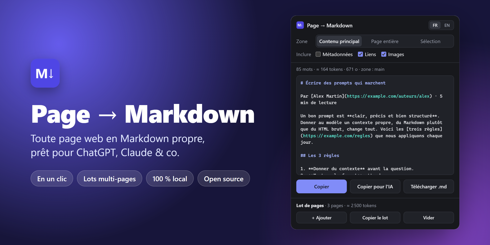

<div align="center">


# Page → Markdown

**Transformez n'importe quelle page web en Markdown propre, prêt pour ChatGPT, Claude & co.**<br>
En un clic. Lots multi-pages. Rien ne quitte votre navigateur.

[**⬇️ Télécharger**](https://github.com/sofian-ezahery/page-to-md/archive/refs/heads/main.zip) &nbsp;·&nbsp; [Installer en 30 secondes](#-installer-en-30-secondes) &nbsp;·&nbsp; [🇬🇧 Read in English](README.md)




</div>

## Pourquoi ?

Collez une page web dans une IA et vous collez aussi le menu, le bandeau cookies, les « articles similaires » et une mise en forme cassée. Donnez-lui le HTML brut et vous gaspillez votre fenêtre de contexte en balises.

**Page → Markdown ne garde que l'essentiel** (titres, paragraphes, listes, tableaux, liens, formules) dans le format que les LLM lisent le mieux.

## ✨ Fonctionnalités

| | |
| --- | --- |
| 🎯 **Extraction intelligente** | Trouve le contenu principal et écarte menus, en-têtes, barres latérales, commentaires, bandeaux cookies et boutons de partage. |
| 📚 **Lots multi-pages** | Collectez plusieurs pages au fil de votre navigation, puis collez-les d'un coup dans une IA. |
| 🤖 **Copier pour l'IA** | Entoure chaque page de balises `<document>` avec son URL source, la structure recommandée par Anthropic pour les longs documents dans les prompts Claude. |
| 🧱 **Vraie structure** | Titres, gras et italique, listes imbriquées, tableaux, citations, blocs de code avec leur langage, images avec légende. |
| ∑ **Formules → LaTeX** | Les formules de Wikipédia, KaTeX et MathML deviennent `$…$` et `$$…$$`. |
| ✂️ **3 modes** | Contenu principal, page entière, ou seulement votre sélection. |
| 🏷️ **En-tête YAML** | Titre, URL, description, auteur et dates, en option. |
| 🔢 **Mots et tokens** | Vous savez combien ça pèse avant de coller. |
| 🌍 **Français et anglais** | L'interface change de langue en un clic. |
| 🔒 **Confidentiel par conception** | Ni serveur, ni compte, ni pistage. Elle ne s'exécute que quand vous cliquez. |

## 🤖 Pensée pour les LLM

**Copier pour l'IA** vous donne un bloc que tous les modèles comprennent :

```xml
<document>
<source>https://example.com/blog/prompts</source>
<document_content>
# Écrire des prompts qui marchent
…
</document_content>
</document>
```

Les **lots** vont plus loin : ajoutez quelques pages avec **+ Ajouter**, cliquez sur **Copier le lot**, et chaque page arrive dans un `<document index="…">` numéroté à l'intérieur de `<documents>`. Il ne reste qu'à demander *« Compare le document 1 et le document 3 »*.

> 💡 Décochez **Liens** quand seul le texte compte : sur les pages pleines de liens comme Wikipédia, le nombre de tokens peut presque être divisé par deux.

## 👀 Exemple

L'article d'exemple de la capture contient un menu, un bandeau cookies, une barre latérale et un pied de page. Voici ce que vous obtenez :

```markdown
---
title: "Écrire des prompts qui marchent | Le Carnet IA"
url: "https://example.com/blog/prompts"
description: "Trois règles simples pour obtenir de meilleures réponses de n'importe quel LLM."
lang: "fr"
extracted: "2026-10-22T19:52:52.607Z"
---

# Écrire des prompts qui marchent

Par [Alex Martin](https://example.com/auteurs/alex) · 5 min de lecture

Un bon prompt est **clair, précis et bien structuré**. Donner au modèle un contexte propre, du Markdown plutôt que du HTML brut, change tout. Voici les [trois règles](https://example.com/regles) que nous appliquons chaque jour.

## Les 3 règles

1. **Donner du contexte** avant la question.
2. **Montrer le format** attendu.
3. **Retirer le bruit** : menus, pubs, bandeaux cookies.

## Antisèche

| Entrée | Résultat |
| --- | --- |
| HTML brut | Bruyant, coûteux |
| Markdown propre | Ciblé, compact |

> Des données propres, des réponses propres.
```

Plus de menu, de bandeau cookies, de barre latérale ni de pied de page.

## 🚀 Installer en 30 secondes

1. **[Téléchargez le ZIP](https://github.com/sofian-ezahery/page-to-md/archive/refs/heads/main.zip)** et décompressez-le.
2. Ouvrez `chrome://extensions` et activez le **Mode développeur** (en haut à droite).
3. Cliquez sur **Charger l'extension non empaquetée** et choisissez le dossier décompressé `page-to-md-main`.
4. Épinglez-la depuis le menu 🧩. C'est prêt !

Cliquez ensuite sur l'icône **M↓**, ou faites **Alt + Maj + M**, sur n'importe quelle page. Si le raccourci est déjà pris, choisissez-en un autre dans `chrome://extensions/shortcuts`.

Conçue et testée sur Chrome. Les autres navigateurs Chromium (Edge, Brave, Arc, Opera…) chargent les extensions non empaquetées de la même façon.

## 🔒 Confidentialité et permissions

Page → Markdown lit une page **uniquement quand vous l'ouvrez** : rien ne tourne en arrière-plan sur les sites que vous visitez. Tout se passe sur votre ordinateur. Il n'y a ni serveur, ni statistiques, ni compte, et vos options comme votre lot restent dans votre navigateur.

| Permission | Pourquoi |
| --- | --- |
| `activeTab` | Lire l'onglet sur lequel vous avez cliqué, et seulement celui-là. |
| `scripting` | Lancer l'extraction dans cet onglet. |
| `storage` | Garder votre lot pendant que vous passez d'une page à l'autre. |

## ❓ FAQ

**Pourquoi du Markdown plutôt que du HTML ou du JSON ?**
Le Markdown garde la structure (titres, listes, tableaux) presque sans surcoût. Il consomme bien moins de tokens que le HTML ou le JSON, et c'est le format que les LLM lisent le plus naturellement.

**Quelles pages ne marchent pas ?**
Chrome interdit les extensions sur les pages `chrome://`, le Chrome Web Store et le lecteur PDF intégré. Le texte dans les iframes, les canvas ou les images n'est pas extrait. Pour les fichiers locaux, activez **Autoriser l'accès aux URL de fichier** dans les détails de l'extension.

**Est-elle sur le Chrome Web Store ?**
Pas encore. Installez-la en mode développeur : ça prend 30 secondes.

## 🛠️ Sous le capot

Ni framework, ni compilation, ni dépendance : moins de 800 lignes de JavaScript pur, lisibles le temps d'un café.

```text
manifest.json        Manifest V3 : permissions et raccourci
extractor.js         Trouve le contenu principal et écrit le Markdown (s'exécute dans la page)
popup.html/css/js    Le popup : options, aperçu, copie, lot, FR/EN
_locales/            Nom et description de l'extension (EN/FR)
icons/               Icônes
docs/                Images du README
```

Modifiez un fichier, puis cliquez sur ⟳ sur la carte de l'extension dans `chrome://extensions` pour la recharger.

## 🤝 Contribuer

Une page mal convertie ? [Ouvrez une issue](https://github.com/sofian-ezahery/page-to-md/issues) avec son URL. Les pull requests sont bienvenues.

## 📄 Licence

[MIT](LICENSE) © 2026 Sofian

<div align="center">
<br>
Si Page → Markdown vous fait gagner du temps, une ⭐ aide d'autres personnes à la trouver.
</div>
