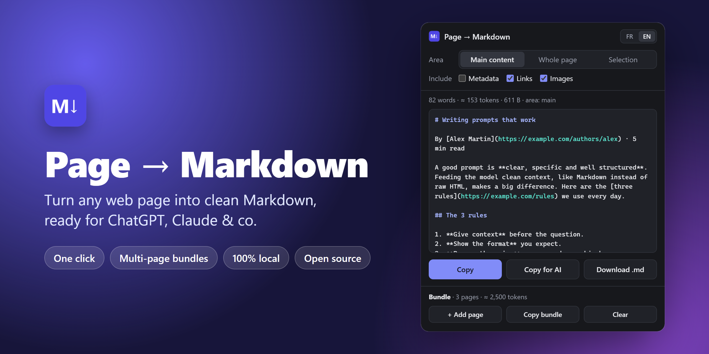

<div align="center">


# Page → Markdown

**Turn any web page into clean Markdown, ready for ChatGPT, Claude & co.**<br>
One click. Multi-page bundles. Nothing leaves your browser.

[**⬇️ Download**](https://github.com/sofian-ezahery/page-to-md/archive/refs/heads/main.zip) &nbsp;·&nbsp; [Install in 30 seconds](#-install-in-30-seconds) &nbsp;·&nbsp; [🇫🇷 Lire en français](README.fr.md)




</div>

## Why?

Paste a web page into an AI and you also paste the menu, the cookie banner, the "related articles" and a pile of broken formatting. Feed it raw HTML instead and you burn your context window on tags.

**Page → Markdown keeps only what matters** (headings, paragraphs, lists, tables, links, formulas) in the format LLMs read best.

## ✨ Features

| | |
| --- | --- |
| 🎯 **Smart extraction** | Finds the main content and drops menus, headers, sidebars, comments, cookie banners and share buttons. |
| 📚 **Multi-page bundles** | Collect several pages as you browse, then paste them into an AI in one go. |
| 🤖 **Copy for AI** | Wraps each page in `<document>` tags with its source URL, the layout Anthropic recommends for long documents in Claude prompts. |
| 🧱 **Real structure** | Headings, bold and italic, nested lists, tables, quotes, code blocks with their language, images with captions. |
| ∑ **Math → LaTeX** | Formulas from Wikipedia, KaTeX and MathML become `$…$` and `$$…$$`. |
| ✂️ **3 modes** | Main content, whole page, or just your selection. |
| 🏷️ **YAML front matter** | Optional title, URL, description, author and dates. |
| 🔢 **Word & token count** | Know how big it is before you paste it. |
| 🌍 **English & French** | Switch the interface in one click. |
| 🔒 **Private by design** | No server, no account, no tracking. It only runs when you click. |

## 🤖 Built for LLMs

**Copy for AI** gives you a block any model understands:

```xml
<document>
<source>https://example.com/blog/prompts</source>
<document_content>
# Writing prompts that work
…
</document_content>
</document>
```

**Bundles** go one step further: add a few pages with **+ Add page**, hit **Copy bundle**, and every page lands in a numbered `<document index="…">` inside `<documents>`. Then just ask *"Compare document 1 and document 3"*.

> 💡 Uncheck **Links** when only the text matters: on link-heavy pages like Wikipedia it can almost halve the token count.

## 👀 Example

The sample article in the screenshot comes with a menu, a cookie banner, a sidebar and a footer. Here is what you get:

```markdown
---
title: "Writing prompts that work | The AI Notebook"
url: "https://example.com/blog/prompts"
description: "Three simple rules to get better answers from any LLM."
lang: "en"
extracted: "2026-10-22T19:52:52.607Z"
---

# Writing prompts that work

By [Alex Martin](https://example.com/authors/alex) · 5 min read

A good prompt is **clear, specific and well structured**. Feeding the model clean context, like Markdown instead of raw HTML, makes a big difference. Here are the [three rules](https://example.com/rules) we use every day.

## The 3 rules

1. **Give context** before the question.
2. **Show the format** you expect.
3. **Remove the noise**: menus, ads, cookie banners.

## Cheat sheet

| Input | Result |
| --- | --- |
| Raw HTML | Noisy, expensive |
| Clean Markdown | Focused, compact |

> Garbage in, garbage out.
```

No menu, no cookie banner, no sidebar, no footer.

## 🚀 Install in 30 seconds

1. **[Download the ZIP](https://github.com/sofian-ezahery/page-to-md/archive/refs/heads/main.zip)** and unzip it.
2. Open `chrome://extensions` and turn on **Developer mode** (top right).
3. Click **Load unpacked** and pick the unzipped `page-to-md-main` folder.
4. Pin it from the 🧩 menu. Done!

Then click the **M↓** icon, or press **Alt + Shift + M**, on any page. If the shortcut is already taken, pick another one in `chrome://extensions/shortcuts`.

Built and tested on Chrome. Other Chromium browsers (Edge, Brave, Arc, Opera…) load unpacked extensions the same way.

## 🔒 Privacy & permissions

Page → Markdown reads a page **only when you open it**: nothing runs in the background on the sites you visit. Everything happens on your computer. There is no server, no analytics and no account, and your options and bundle stay in your browser.

| Permission | Why |
| --- | --- |
| `activeTab` | Read the tab you clicked the icon on, and only that one. |
| `scripting` | Run the extractor in that tab. |
| `storage` | Keep your bundle while you move from page to page. |

## ❓ FAQ

**Why Markdown and not HTML or JSON?**
Markdown keeps the structure (headings, lists, tables) with almost no overhead. It costs far fewer tokens than HTML or JSON, and it is the format LLMs read most naturally.

**Which pages won't work?**
Chrome blocks extensions on `chrome://` pages, the Chrome Web Store and the built-in PDF viewer. Text inside iframes, canvases or images isn't extracted. For local files, turn on **Allow access to file URLs** in the extension details.

**Is it on the Chrome Web Store?**
Not yet. Install it in developer mode: it takes 30 seconds.

## 🛠️ Under the hood

No framework, no build step, no dependencies: under 800 lines of plain JavaScript you can read over a coffee.

```text
manifest.json        Manifest V3: permissions and shortcut
extractor.js         Finds the main content and writes the Markdown (runs in the page)
popup.html/css/js    The popup: options, preview, copy, bundle, FR/EN
_locales/            Extension name and description (EN/FR)
icons/               Icons
docs/                README images
```

Change a file, then click ⟳ on the extension card in `chrome://extensions` to reload it.

## 🤝 Contributing

A page that converts badly? [Open an issue](https://github.com/sofian-ezahery/page-to-md/issues) with its URL. Pull requests are welcome.

## 📄 License

[MIT](LICENSE) © 2026 Sofian

<div align="center">
<br>
If Page → Markdown saves you time, a ⭐ helps other people find it.
</div>
